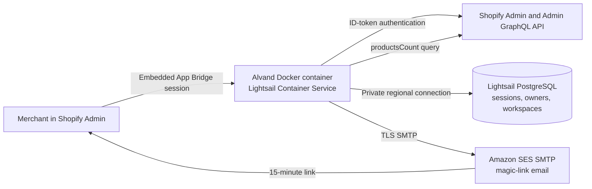
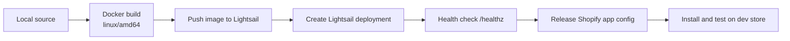

# Alvand on AWS: Deployment Runbook

This runbook documents the deployment completed for Alvand and provides a
repeatable path for future releases. It uses the simplest AWS architecture we
selected for the first production-style deployment:

- Amazon Lightsail Container Service for the Docker application
- Amazon Lightsail Managed PostgreSQL for Prisma data and Shopify sessions
- Amazon SES for magic-link email
- Shopify CLI for app configuration releases

The commands are written for PowerShell on Windows. Never paste passwords,
Shopify secrets, SMTP credentials, or a complete `DATABASE_URL` into chat,
source control, screenshots, or issue trackers.

## Current deployment

| Setting | Value |
| --- | --- |
| AWS Region | `ca-central-1` (Canada Central) |
| Container service | `alvand` |
| Container size | `nano`, scale `1` |
| Database resource | `db-test-canada` |
| Database engine | PostgreSQL |
| Public app URL | `https://alvand.796x64n7r6y9a.ca-central-1.cs.amazonlightsail.com` |
| Shopify scope | `read_products` |
| Shopify API version | `2026-10` |
| Released Shopify version | `alvand-2` |
| SES Region | `ca-central-1` |

The generated Lightsail hostname is suitable for initial testing. Use a stable
custom domain before broad public launch so the Shopify URL does not depend on
an infrastructure-generated hostname.

## Big picture



Each Shopify store installs and authorizes Alvand independently. The backend
stores no products: it requests the live product count from each authorized
store and stores only installation sessions, owner identities, workspaces,
store connections, and hashed one-time tokens.

## Release flow



## 1. Prerequisites

Install and start:

- Docker Desktop with the Linux container engine
- AWS CLI v2.32 or newer
- `lightsailctl`
- Node.js 22.12 or newer
- Shopify CLI

Verify the tools:

```powershell
docker version
aws --version
Get-Command lightsailctl | Select-Object Source
node --version
shopify version
```

Install `lightsailctl` without requiring a machine-wide PATH change:

```powershell
$pluginDir = "$env:LOCALAPPDATA\Programs\lightsailctl"
New-Item -ItemType Directory -Force -Path $pluginDir | Out-Null

Invoke-WebRequest `
  -Uri "https://s3.us-west-2.amazonaws.com/lightsailctl/latest/windows-amd64/lightsailctl.exe" `
  -OutFile "$pluginDir\lightsailctl.exe"

Unblock-File "$pluginDir\lightsailctl.exe"

$userPath = [Environment]::GetEnvironmentVariable("Path", "User")
if (($userPath -split ";") -notcontains $pluginDir) {
    [Environment]::SetEnvironmentVariable(
        "Path",
        ($userPath.TrimEnd(";") + ";" + $pluginDir),
        "User"
    )
}
```

Close and reopen PowerShell after changing PATH.

## 2. Authenticate to AWS

Use browser-based login, which creates temporary credentials instead of
placing permanent AWS access keys on the computer:

```powershell
aws login --region ca-central-1
aws sts get-caller-identity
```

The session can last up to 12 hours. Run `aws login` again when it expires.
Do not publish the account ID or ARN returned by the identity command.

Set reusable deployment variables:

```powershell
$Region = "ca-central-1"
$ServiceName = "alvand"
$DatabaseResourceName = "db-test-canada"
$AppUrl = "https://alvand.796x64n7r6y9a.ca-central-1.cs.amazonlightsail.com"
```

## 3. Create the managed PostgreSQL database

The database was created in the Lightsail console in Canada Central. For this
architecture, keep public access disabled and place the database and container
service in the same Region.

Confirm its state and connection metadata:

```powershell
aws lightsail get-relational-database `
  --relational-database-name $DatabaseResourceName `
  --region $Region `
  --query "relationalDatabase.{State:state,Host:masterEndpoint.address,Port:masterEndpoint.port,User:masterUsername,MasterDatabase:masterDatabaseName,Public:publiclyAccessible}" `
  --output table
```

Wait for `State` to be `available`. `Public` should be `False`.

Load the connection information into the current PowerShell process without
printing the password:

```powershell
$db = (
    aws lightsail get-relational-database `
      --relational-database-name $DatabaseResourceName `
      --region $Region |
    ConvertFrom-Json
).relationalDatabase

$dbPassword = aws lightsail get-relational-database-master-user-password `
  --relational-database-name $DatabaseResourceName `
  --region $Region `
  --query "masterUserPassword" `
  --output text

$databaseUrl = "postgresql://$($db.masterUsername):$([uri]::EscapeDataString($dbPassword))@$($db.masterEndpoint.address):$($db.masterEndpoint.port)/$($db.masterDatabaseName)?schema=public&sslmode=require"
```

Do not print `$databaseUrl`.

## 4. Create the Lightsail container service

Create the initial low-cost service:

```powershell
aws lightsail create-container-service `
  --service-name $ServiceName `
  --power nano `
  --scale 1 `
  --region $Region
```

Check its state:

```powershell
aws lightsail get-container-services `
  --service-name $ServiceName `
  --region $Region `
  --query "containerServices[0].state" `
  --output text
```

Continue after it reports `READY`.

## 5. Build and upload the application image

Run these commands from the repository root:

```powershell
Set-Location "C:\Users\hahma\OneDrive\Documents2\data\alvand\source-code\alvand"
docker build --platform linux/amd64 -t alvand:latest .
```

The Dockerfile must install development dependencies before `npm run build`,
then prune them afterward. The working sequence is:

```dockerfile
RUN npm ci
COPY . .
RUN npm run build
RUN npm prune --omit=dev && npm cache clean --force
```

Push the image:

```powershell
aws lightsail push-container-image `
  --service-name $ServiceName `
  --label alvand `
  --image alvand:latest `
  --region $Region
```

Capture the newest Lightsail image identifier:

```powershell
$image = (
    aws lightsail get-container-images `
      --service-name $ServiceName `
      --region $Region `
      --query "containerImages[0].image" `
      --output text
).Trim()
```

It resembles `:alvand.alvand.3`. Do not hardcode the sequence number in a
routine deployment; always query the newest image as shown above.

## 6. Load Shopify application credentials

From the linked Shopify project, load the values without displaying them:

```powershell
$shopifyVars = shopify app env show --no-color | ConvertFrom-StringData

if ($shopifyVars.SHOPIFY_API_KEY -and $shopifyVars.SHOPIFY_API_SECRET) {
    "Shopify credentials loaded"
}
```

Complete Shopify's browser login if prompted. Keep this PowerShell session
open because the following commands use these in-memory values.

## 7. Configure Amazon SES

### Verify a sender identity

```powershell
$senderEmail = Read-Host "Enter the email address Alvand will send from"
aws sesv2 create-email-identity `
  --email-identity $senderEmail `
  --region $Region
```

Open the verification email and follow its link. Check the result:

```powershell
aws sesv2 get-email-identity `
  --email-identity $senderEmail `
  --region $Region `
  --query "VerifiedForSendingStatus" `
  --output text
```

### Create SMTP credentials

In the SES console for Canada Central:

1. Open **SMTP settings**.
2. Choose **IAM SMTP credentials**, not Mail Manager SMTP. Mail Manager adds
   functionality and processing charges that this app does not need.
3. Choose **Create SMTP credentials**.
4. Use IAM username `alvand-ses-smtp`.
5. Create the user and download the CSV immediately.

Load the downloaded CSV. The current CSV headers use spaces and are exactly
`SMTP user name` and `SMTP password`:

```powershell
$csvPath = (Read-Host "Paste the full path to the downloaded CSV").Trim('"')
$smtpCredentials = Import-Csv $csvPath
$smtpUser = $smtpCredentials.'SMTP user name'
$smtpPassword = $smtpCredentials.'SMTP password'
$smtpUrl = "smtps://$([uri]::EscapeDataString($smtpUser)):$([uri]::EscapeDataString($smtpPassword))@email-smtp.ca-central-1.amazonaws.com:465"
```

Verify only lengths, never values:

```powershell
[PSCustomObject]@{
    SMTPUsernameLength = ([string]$smtpUser).Length
    SMTPPasswordLength = ([string]$smtpPassword).Length
    SMTPUrlLength      = ([string]$smtpUrl).Length
} | Format-List
```

For the credentials created during this deployment, the observed username and
password lengths were 20 and 44. Lengths can be checked safely; credential
values must remain private.

### SES sandbox limitation

While SES is in its sandbox, Alvand can send only to verified recipient
addresses. Testing with the same verified sender address is valid. Before real
merchant use, request SES production access in Canada Central and describe the
transactional magic-link use case, expected volume, bounce handling, and
complaint handling.

## 8. Create and deploy the container configuration

Create the deployment model in memory:

```powershell
$containers = @{
    app = @{
        image = $image
        ports = @{ "3000" = "HTTP" }
        environment = @{
            DATABASE_URL       = $databaseUrl
            SHOPIFY_API_KEY    = $shopifyVars.SHOPIFY_API_KEY
            SHOPIFY_API_SECRET = $shopifyVars.SHOPIFY_API_SECRET
            SHOPIFY_APP_URL    = $AppUrl
            SCOPES             = "read_products"
            SMTP_URL           = $smtpUrl
            EMAIL_FROM         = $senderEmail
            SUPPORT_EMAIL      = $senderEmail
            PORT               = "3000"
        }
    }
}

$endpoint = @{
    containerName = "app"
    containerPort = 3000
    healthCheck = @{
        path = "/healthz"
        successCodes = "200-399"
    }
}
```

Write temporary JSON without a UTF-8 byte-order mark, because AWS CLI JSON
parsing can reject BOM-prefixed files:

```powershell
$deployDir = Join-Path $env:TEMP "alvand-lightsail"
New-Item -ItemType Directory -Force -Path $deployDir | Out-Null

$containersFile = Join-Path $deployDir "containers.json"
$endpointFile = Join-Path $deployDir "endpoint.json"

[IO.File]::WriteAllText(
    $containersFile,
    ($containers | ConvertTo-Json -Depth 6),
    [Text.UTF8Encoding]::new($false)
)

[IO.File]::WriteAllText(
    $endpointFile,
    ($endpoint | ConvertTo-Json -Depth 6),
    [Text.UTF8Encoding]::new($false)
)
```

The container JSON contains secrets. Do not commit it.

Create the deployment:

```powershell
aws lightsail create-container-service-deployment `
  --service-name $ServiceName `
  --containers "file://$($containersFile.Replace('\','/'))" `
  --public-endpoint "file://$($endpointFile.Replace('\','/'))" `
  --region $Region
```

Monitor the deployment:

```powershell
aws lightsail get-container-services `
  --service-name $ServiceName `
  --region $Region `
  --query "containerServices[0].{ServiceState:state,CurrentDeployment:currentDeployment.state,NextDeployment:nextDeployment.state}" `
  --output table
```

The finished state is:

- `ServiceState`: `READY`
- `CurrentDeployment`: `ACTIVE`
- `NextDeployment`: blank

Verify application health:

```powershell
Invoke-WebRequest "$AppUrl/healthz" | Select-Object StatusCode, Content
```

After deployment, remove local temporary files that contain secrets:

```powershell
Remove-Item -LiteralPath $containersFile -Force
Remove-Item -LiteralPath $endpointFile -Force
```

Store or remove the SMTP CSV according to the organization's credential
handling policy. If it is exposed, delete the IAM SMTP user and generate new
credentials.

## 9. Release the Shopify production configuration

`shopify.app.toml` uses the Lightsail URL:

```toml
application_url = "https://alvand.796x64n7r6y9a.ca-central-1.cs.amazonlightsail.com"

[auth]
redirect_urls = ["https://alvand.796x64n7r6y9a.ca-central-1.cs.amazonlightsail.com/api/auth"]
```

Validate and release:

```powershell
shopify app config validate --json
shopify app deploy
```

The validator should report `"valid": true`. The deploy command creates and
releases a Shopify app version; it does not upload the Docker image.

## 10. Install and test on a development store

1. Open Alvand in the Shopify Dev Dashboard.
2. In **Installs**, choose **Install app**.
3. Select a development store and approve the installation.
4. Open Alvand inside Shopify Admin.
5. Request a magic link using the SES-verified address while SES is sandboxed.
6. Open the link and press **Verify email**.
7. Return to Shopify Admin, reopen Alvand, create a workspace, and attach the
   store. Do not navigate directly to the hosted `/app` URL because embedded
   authentication requires the Shopify Admin context.
8. Confirm **Hello, world!** and the expected product count.
9. Add products in active, draft, archived, and unlisted states and confirm
   they are all counted.

## 11. Email-link scanner protection

Email providers and corporate security products often open links before the
recipient does. A magic-link GET request must therefore not consume the token.

Alvand's corrected flow is:

1. `GET /magic/verify?token=...` checks the token and displays a confirmation
   page without consuming it.
2. The user presses **Verify email**.
3. `POST /magic/verify` atomically consumes the token and links the Shopify
   principal.

After deploying this change, request a new magic link. A token consumed by the
old implementation cannot be recovered or reused.

## 12. Routine application redeployment

For each code release:

```powershell
npm test
npm run typecheck
npm run lint
npm run build

docker build --platform linux/amd64 -t alvand:latest .

aws lightsail push-container-image `
  --service-name $ServiceName `
  --label alvand `
  --image alvand:latest `
  --region $Region

$image = (
    aws lightsail get-container-images `
      --service-name $ServiceName `
      --region $Region `
      --query "containerImages[0].image" `
      --output text
).Trim()

$containers.app.image = $image
[IO.File]::WriteAllText(
    $containersFile,
    ($containers | ConvertTo-Json -Depth 6),
    [Text.UTF8Encoding]::new($false)
)

aws lightsail create-container-service-deployment `
  --service-name $ServiceName `
  --containers "file://$($containersFile.Replace('\','/'))" `
  --public-endpoint "file://$($endpointFile.Replace('\','/'))" `
  --region $Region
```

Only run `shopify app deploy` when Shopify configuration, scopes, webhook
subscriptions, or extensions have changed. Application code-only changes need
only a new Docker/Lightsail deployment.

## 13. Troubleshooting

### AWS says `Unable to locate credentials`

```powershell
aws login --region ca-central-1
aws sts get-caller-identity
```

### Deployment remains `PENDING` or `DEPLOYING`

Query both current and next deployments:

```powershell
aws lightsail get-container-services `
  --service-name $ServiceName `
  --region $Region `
  --query "containerServices[0].{ServiceState:state,CurrentDeployment:currentDeployment.state,NextDeployment:nextDeployment.state}" `
  --output table
```

Read recent application logs:

```powershell
aws lightsail get-container-log `
  --service-name $ServiceName `
  --container-name app `
  --region $Region
```

### Prisma error `P3015: Could not find the migration file`

Prisma found a migration directory without `migration.sql`. The stale empty
directory encountered during this deployment was:

```text
prisma/migrations/20240530213853_create_session_table
```

It was removed because the tracked PostgreSQL initial migration already
creates the `Session` table. Confirm each remaining migration directory
contains `migration.sql`, rebuild the image, push it, and deploy again.

```powershell
Get-ChildItem prisma\migrations -Force -Recurse
```

### Docker build cannot find React Router build tools

Do not use `npm ci --omit=dev` before `npm run build`. Install all dependencies,
build, then run `npm prune --omit=dev` as shown in section 5.

### SMTP username length is zero

List only CSV field names:

```powershell
$smtpCredentials.PSObject.Properties.Name
```

The current SES CSV headers are `SMTP user name` and `SMTP password`, not
`SMTP Username` and `SMTP Password`.

### Magic link is expired or already used immediately

- Confirm the application includes the GET-confirmation/POST-consumption fix.
- Deploy a fresh image.
- Request a new link; old consumed links remain invalid.
- Use a verified recipient while SES is sandboxed.
- Confirm the link was opened within 15 minutes.

### Health check passes but Shopify installation fails

Verify all three values use the same HTTPS origin:

- `SHOPIFY_APP_URL` in the container environment
- `application_url` in `shopify.app.toml`
- `[auth].redirect_urls` in `shopify.app.toml`

Then run:

```powershell
shopify app config validate --json
shopify app deploy
```

## 14. Production-readiness work still required

Before submitting for public App Store review:

- Request SES production access in `ca-central-1`.
- Verify a sending domain and configure DKIM, SPF, and DMARC instead of relying
  only on a single verified email address.
- Add a custom domain and update `SHOPIFY_APP_URL` and `shopify.app.toml`.
- Replace temporary support/legal content with approved privacy, terms,
  support, and status URLs.
- Configure database backups and test restoration.
- Configure AWS billing alerts and operational monitoring.
- Move production secrets to an appropriate managed-secret workflow or tightly
  restrict access to the Lightsail deployment configuration.
- Rotate any credential that appeared in terminal history, screenshots, or an
  unintended file.
- Keep separate development and production Shopify app records.
- Test with at least two development stores, including workspace isolation,
  aggregate counts, scope loss, and uninstall isolation.
- Run Shopify's App Store self-review and automated review checks.
- Revisit the pinned Shopify API version quarterly.

## Official references

- [Shopify: deploy to a hosting service](https://shopify.dev/docs/apps/launch/deployment/deploy-to-hosting-service)
- [Shopify: test and pass app review](https://shopify.dev/docs/apps/launch/app-store-review/pass-app-review)
- [AWS: install Lightsail software](https://docs.aws.amazon.com/lightsail/latest/userguide/amazon-lightsail-install-software.html)
- [AWS: sign in through the AWS CLI](https://docs.aws.amazon.com/signin/latest/userguide/command-line-sign-in.html)
- [AWS: verify SES identities](https://docs.aws.amazon.com/ses/latest/dg/creating-identities.html)
- [AWS: obtain SES SMTP credentials](https://docs.aws.amazon.com/ses/latest/dg/smtp-credentials.html)

